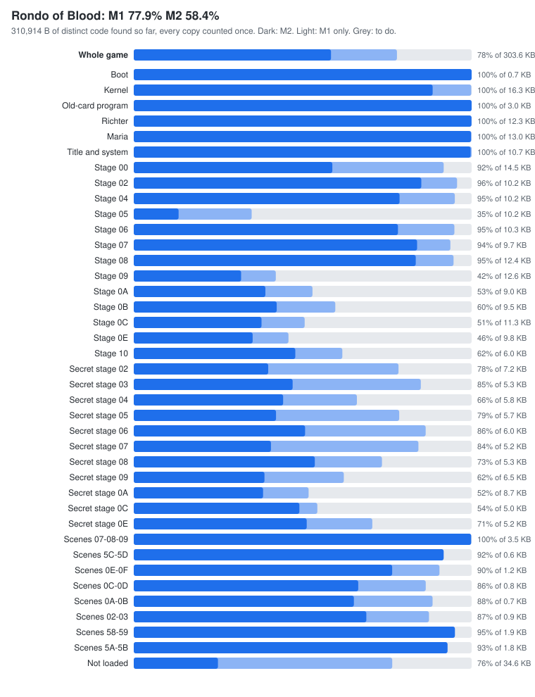

# Rondo of Blood: bit-exact decompilation

**Started November 3, 2026. Not finished: no routine is certified yet
(M1 and M2 are both 0). See [Current Status](#current-status) for what the
gates measure.** All of the code the test scripts run rebuilds as assembly,
byte for byte on the disc: named by hand where a routine is filed, and
labelled only by address (the raw intake) where it is not. Proper C has
been written for 1,945 game routines (counted on 2026-11-25); it is being
proven against the running original call by call (gate A5) and in lockstep
(gate A7).

**Measured size: 114,441 B of distinct game code in whole routines**, run
by 33 scripts and measured at `55f97e9`. A 34th script, added on
2026-11-25, raises that floor. The code no script has run is not yet in
the count, so the true total is larger ([how it is measured](#how-large)).

| | Decompilation | Exact to |
|---|---|---|
| **ASM** | symbolic, commented HuC6280 assembly | the original, bit for bit: the disc's data track rebuilt with 0 differing bytes |
| **C** | proper C: typed arguments and returns, locals, loops, structs and named RAM | the original's behaviour: each routine's inputs to outputs, proven against the running original |

The game was written in assembly, so it has two decompilations, held to
the standard of the SNES decomps (Stunt Race FX, Aladdin). The C is C, not
assembly written in C's syntax: no register file, no flag helpers, no
gotos standing in for branches. It sets a register or flag only where the
original leaves one visible to its caller, at a wait or to a callee, and
only in the small wrapper that meets the assembly's calling convention.
The C states no instruction timing: instruction counts are an emulator's
bookkeeping and were never part of the original source.

**Maintainer:** Jeffrey Wilbur, Strut B, LLC\
**Contact:** [retro@strutb.com](mailto:retro@strutb.com)

## License, and no claim to the game

**I claim no ownership whatsoever of the decompiled source code.**
*Akumajou Dracula X: Chi no Rondo*, its code and its assets belong to its
rights holders. The assembly and C in this repository are a reconstruction
of their work, recovered so that they rebuild the original bytes. It is
not mine to own, license or give away, and nothing here says otherwise. No
game data ships in this repository: every build starts from your own copy
of the disc.

This project exists for preservation and for love of this game, so that
the Castlevania Konami made for the PC Engine CD in 1993 can still be
read, studied, built and played long after the discs, System Cards and
hardware it shipped on are gone.

The work that is my own (the tools and the test harness) is dedicated to
the public domain under [CC0 1.0 Universal](LICENSE). Anyone may use it for
any purpose, with no permission or credit needed.

**Why CC0.** A preservation project should claim as little as possible.
CC0 asserts nothing over the reconstructed game, and it gives everything
that is mine to the public domain, with a fallback licence for countries
where copyright cannot be waived outright. That fallback is why CC0 was
chosen over the Unlicense, which has the same intent but no fallback.

## The Decompilation Standard

The purpose of a decompilation, as opposed to a recompilation, is
preservation: recovering the game itself, as written, in a form that
outlives the original hardware and media. Playability and portability are
welcome side effects, not the direct goal. With a bit-exact decompilation,
every function, built with the original compiler, must reproduce the
original machine code byte for byte. A bit-exact match is 100% reliability
that the source is accurate to the original, ensuring preservation for
future generations.

## Project Purpose

A decompilation of *Akumajou Dracula X: Chi no Rondo* (PC Engine Super
CD-ROM², 1993), known in the West as *Rondo of Blood*, in two forms. In
assembly, every routine symbolic and commented, and the whole data track
rebuilt from it byte for byte. In C, every routine rewritten as proper C,
documented with what it does and how, filed by what it is for, and proven
to behave exactly like the original. Progress is measured only by those
two proofs; playability is a consequence, never a reason to reorder the
work.

## Game background

Konami released *Akumajou Dracula X: Chi no Rondo* in Japan on October 29,
1993. It is a Super CD-ROM² title: it needs NEC's System Card 3.0, and
its boot program reads the game into the card's extra 192 KB of RAM.
Richter Belmont crosses Dracula's castle to rescue the women taken from
his village. It has branching stages, a second playable character, an
animated opening and spoken cutscenes, and most of its music is Red Book
audio played from the disc. It stayed in Japan until *Castlevania: The
Dracula X Chronicles* (PSP, 2007), which carries the original game inside
it, as the Wii's Virtual Console release and *Castlevania Requiem* (PS4,
2018) later did.

The machine is small and unusual. One processor, Hudson's HuC6280 (a
65C02 with block moves, an 8-bank memory mapper and a 6-channel wavetable
sound generator on the chip), runs everything: game logic, video and the
PSG sound driver. The HuC6270 video controller and the HuC6260 colour
encoder draw the picture. The CD unit adds 64 KB of RAM, an ADPCM voice
chip and CD-DA playback. No compiler footprint is expected: PC Engine
games of the time were written in assembly. That is confirmed from traced
code, not assumed.

## How a CD game differs from a cartridge

On a HuCard, or a SNES cartridge, the code sits in ROM at fixed
addresses. Here there is no ROM. The System Card's boot reads one sector
of the disc to $3000 and runs it. That program reads the game in through
the card's BIOS, into Super System Card RAM, and the game goes on reading
pieces of itself into the same RAM as it moves from stage to stage. So:

- **The image is the disc's data track:** track 02's 10,149 user sectors
  (20,785,152 B), code and data together. The image gate re-encodes them
  into the raw BIN (sync, header, EDC, P and Q parity) and compares
  against the original. Track 22 is the disc's backup copy of track 02's
  first 9,999 sectors and is rebuilt from the same bytes.
- **A routine is named by where it lies on the disc** (`@routine
  0043:000`: sector $43, offset 0, counted as the game's loader counts),
  with `@run` giving the bank and address it runs at, since pieces loaded
  at different times share run addresses.
- **Code bytes are found by folding RAM execution back onto the disc**
  sectors that loaded it, as the SNES decomps fold the sound CPU's RAM
  onto the ROM bytes uploaded there.
- **The System Card's BIOS is not the game's code.** It is called through
  its $E000 jump table, and is decompiled as its own project in
  `syscard/`, never counted in the game's progress.

## Two decompilations, one game

When a game was compiled from C, the right C fed to the original compiler
gives back the original bytes, so one source carries both proofs. No
compiler produced these bytes, so no C can rebuild them. Each routine
therefore has two decompilations, as in the Stunt Race FX and Aladdin
decomps:

- **ASM, bit exact.** Symbolic, commented HuC6280 assembly that rebuilds
  the data track byte for byte (T4): every address a name, every routine
  with the same header as its C. Where the two disagree, the assembly and
  the original disc are right.
- **C, behaviour exact.** Proper C per routine: typed arguments and
  returns, locals, loops, structs and named RAM, with each routine's
  calling convention met by a small wrapper and nowhere else. Certified
  against the running original (T3): at every call the scripts make, and
  with every routine swapped in at once, in lockstep with the original,
  frame for frame. Register-shaped C (a register file, flag helpers,
  gotos for branches) does not count as decompiled; at most it is a
  stepping stone, and is reported as one with its count.

## Current Status

<!-- progress:start -->


Measured on `bd03d5f`: gate records from `55f97e9`, every one of the 33 scripts traced and with a gate A7 result.

**Denominator: 114,441 B, the traced floor: the code 33 scripts ran, counted by distinct whole routines (210,151 B by disc location). The static census is not yet in it, so the true total is larger.**

**16 of 1034 routines (933 B) fail the proper-C check: register-shaped C, a stepping stone, not decompiled.** The check is a pattern check, so every count above T2 is a ceiling until reviewed.

| Measure | Routines | Bytes | Of the 114,441 B |
|---|---:|---:|---:|
| M2: T4 | 0 | 0 | 0.00% |
| M1: T3 or better | 0 | 0 | 0.00% |
| of those, real logic and not one-line vectors | 0 | 0 | 0.00% |
| T2: filed, not certified | 1034 | 36,255 | |

Routines short of a gate, overlapping: A7 swap 1034, every byte run 288, A5 judged call 311, symbolic assembly 194, image 0.

The System Card, its own project and [ledger](syscard/ledger.csv), held to the same gates:

| Measure | Routines | Bytes | Of the 4,676 B the scripts run, a floor |
|---|---:|---:|---:|
| M2: T4 | 0 | 0 | 0.00% |
| M1: T3 or better | 0 | 0 | 0.00% |
| T2: filed, not certified | 134 | 6,643 | |
| below proper C | 0 | 0 | |

Card routines short of a gate, overlapping: A7 swap 135, every byte run 84, A5 judged call 47, symbolic assembly 1, image 0.

**A5, each routine's C against the original call by call: 771 routines identical, game 684 and card 87** (246 and 7 divergent, 9 and 0 unverified, 95 and 41 uncovered). M1 and M2 are zero because a routine counts only when every script that reaches it is identical in lockstep with its C in place, and with the legacy C in place 0 of 33 scripts are (the epoch-2 checker also judges access order, interrupts inside calls and frames inside calls).

**Filed C: 1272 game routines have filed C; 886 of them were lifted or reworked since 2026-11-21** (any line of the routine last changed on or after that date, by `git blame`). **Drafted C, a stepping stone and never counted as decompiled: 2,628 of 2,838 register-shaped drafts identical in A5** measured 2026-11-25 by the runner, the A5 of every draft serving.

**Filed C holding in lockstep, a line of its own and not part of M1: 68 routines, 2,678 B**, in the 1 script(s) that came out identical with the filed C in place and drafts serving for every routine that fails the proper-C check or a defect (boot). A routine is T3 only when every script that reaches it is identical with its C in place: 0 routines meet that so far (0 B); the rest wait for the scripts listed in `config/rondo/certification_queue.csv`.

Generated by `tools/rondo/progress.py` from [the ledger](docs/rondo/ledger.csv), which `tools/rondo/ledger.py` works out from the gates.
<!-- progress:end -->

| | State |
|---|---|
| Reference set | 23 files pinned by SHA-1; every MODE1 sector of both data tracks checked (sync, header address, mode, EDC): 0 bad |
| Sector layer | both data tracks rebuilt from user data: 0 differing bytes; a planted byte fails the gate. **This is the disc's encoding, not decompilation progress** |
| Assembly image | the whole data track assembled from source: the filed symbolic assembly, the raw intake for every other traced routine, and the disc's own bytes wherever no script has run. The result is compared with the disc at every landing: 0 differing bytes |
| Assembler | ca65 and ld65 (cc65, pinned) built in the repo. Control: 910 instruction forms over all 234 defined opcodes plus the 22 undefined as data, 2,388 B, 0 differing bytes; dropping one operand size fails it |
| Emulator core | Mednafen's accurate PC Engine (Beetle PCE, pinned) built in the repo with eight local patches: portability, inspection, trace hooks, check hooks, CPU speed, absolute clock, logical address and backup RAM |
| System Cards | Super CD-ROM² System 3.0 (Japan), the target, and the TurboGrafx Super System Card 3.0 (USA), a witness: both pinned by SHA-1. The Japanese card's BIOS is decompiled as its own project under [syscard/](syscard/README.md), with its own ledger |
| Runner | `pcebox` runs the original headless from a script of real input, pokes or unit calls, with every option that bears on emulation set explicitly |
| Scripts | 34: boot; attract and ten attract variants; game over; two menus; the sound test; six seeded random plays; eleven stage scripts; and raster effects, a coverage script that pokes work RAM |
| Tracing | each script's executed bytes are folded back onto the disc bytes they were loaded from, through loads, stores, transfers and block moves. A static census (`census.py`) follows the code no script ran; it is not yet in the denominator |
| Drafts | a tool writes C that follows each traced routine's assembly instruction for instruction. It is a stepping stone and is never counted as decompiled; it lets the checker be proven before the C is |
| Lockstep with drafts | in lockstep with a draft in place for every call, 6 of the 34 scripts are identical to their end: boot, attract, menu_files, menu_names, sound_test and raster_effects. The other 28 are identical in every frame up to their first stop; 27 of them have not been rerun since the checker changed for that stop, and stage_04, rerun, is identical through frame 14,625 and then stops for another cause. Measured by the lockstep sessions on 2026-11-25, to be repeated by the runner. This is not certification |
| Filed C | typed C over the typed access layer, with no register file, flag helper or goto in a body; the registers the original leaves visible are set only in each routine's wrapper. The check for this is a pattern check, and some routines still fail it (above) |
| Lockstep with filed C | no script is identical with all of the filed C in place. The one set that held is named in the status above |
| Not yet done | certification of any routine; the census in the denominator; coverage for the code no script reaches; names for all the assembly (M2) |

The generated block above is the last complete measurement, and gives the
commit it was made at; later landings show up there only after the next
complete one.

### How large

Measured, not estimated: the code the scripts ran, counted by distinct
whole routines, **114,441 B** at `55f97e9`. The disc holds the same code
in many places, so the same routines make 210,151 B counted by disc
location. The measure is a floor: code no script has run is found by the
static census (`census.py`) and has not been added.

`estimate.py` gives an early estimate from a classifier, about 196 KB of
distinct code (131 to 260 KB). It is kept as a check and is not used as a
denominator.

Query the tree. Do not trust a number in this file.

```bash
python3 tools/rondo/disc.py      # pins, every data sector checked, user data split out
python3 tools/rondo/image.py     # image gate: both data tracks rebuilt, 0 differing bytes
python3 tools/rondo/image.py --plant 4100   # must fail
python3 tools/rondo/asmcontrol.py           # ca65 encodes every HuC6280 instruction form exactly
python3 tools/rondo/asmcontrol.py --plant   # must fail
build/rondo/pcebox/pcebox --core tools/toolchains/pce/mednafen_pce_libretro.dylib \
    --cue "references/Akumajou Dracula X - Chi no Rondo (Japan)/Akumajou Dracula X - Chi no Rondo (Japan).cue" \
    --system build/rondo/system --script tools/rondo/scripts/boot.txt --out build/rondo/runs/boot
python3 tools/rondo/loadcheck.py build/rondo/runs/boot/*.ram   # which disc sectors each RAM bank holds
python3 tools/rondo/trace.py      # every script traced in parallel, maps merged, disc consistency enforced
python3 tools/rondo/asmbuild.py   # the whole data track assembled from source; image.py --user compares it
python3 tools/rondo/cdraft.py --cache        # a draft of every traced routine
python3 tools/rondo/liftcmp.py NAME          # one routine's C against its draft, access for access
python3 tools/rondo/oracle.py a5 SCRIPT      # gate A5 on one script (a7: lockstep)
python3 tools/rondo/ledger.py     # what tier each routine has earned, from the gate records
python3 tools/rondo/census.py     # the code no script has run
python3 tools/rondo/estimate.py   # the early code-size estimate and its error
python3 tools/rondo/huc.py build/rondo/disc/track02.bin --org 0x3000 --offset 0x1000 --len 0x130
```

T1 = traced, raw intake only; T2 = C or assembly in the tree, not
certified; T3 = the C is proper C and certified behaviour exact; T4 = T3,
and the routine's assembly is symbolic, documented and byte-identical in
place.
M1 = every routine T3; M2 = every routine T4 and the data track rebuilt
byte exact.

## More

- [docs/rondo/PLAN.md](docs/rondo/PLAN.md): the plan, the standard, what
  differs from the SNES decomps, open decisions and known limits.
- [docs/rondo/HANDBOOK.md](docs/rondo/HANDBOOK.md): what the work has
  learned, one rule per finding.
- [docs/rondo/DECOMP.md](docs/rondo/DECOMP.md): standard, layout and tools
  in one page.
- [docs/rondo/PROCEDURE.md](docs/rondo/PROCEDURE.md): how a routine is
  written, checked and landed.

### Architecture

    src/rondo/              the C decompilation, behaviour exact, by area: audio, math, menu,
                            object, system, and the headers in include/
    asm/rondo/              the ASM decompilation, bit exact, same areas
    syscard/                the System Card's own decompilation (src/, asm/, include/, ledger)
    config/rondo/           symbols, records, tables, gate results, certification queue
    tools/rondo/            disc, image gate, trace, intake, drafts, lift check, oracles, runner,
                            ledger, landing script, and the checker (pcebox/) with its scripts
    tools/toolchains/       pinned cc65 and Beetle PCE (fetched by setup.sh), local patches
    tools/common/           git hooks, provenance check
    docs/rondo/             plan, standard, handbook, dated notes
    references/             the disc and the System Card image (not tracked)
    build/                  everything generated

### Building & Setup

- **`./setup.sh`**: installs the hooks, fetches cc65 and Beetle PCE at
  their pinned commits into the repo and builds them with the local
  patches (nothing installed on the host), checks the disc and the System
  Cards, splits the disc and runs the image gate, then builds `pcebox`.
  The whole setup runs under the machine's job queue; `./setup.sh cc65`,
  `pce`, `pcebox` or `disc` runs one part.

### Reference disc (you supply; not tracked in git)

```
references/Akumajou Dracula X - Chi no Rondo (Japan)/      Redump set, 22 tracks
  ...(Japan).cue                 SHA-1  ebb1350121815493f7179556ca81b8a904a4b05f        2,565 bytes
  ...(Track 02).bin  MODE1/2352  SHA-1  c9b092fb15af2a7436f425bf29ed5d948f9c9640   24,399,648 bytes
                                 MD5    4cb1cb4858b88122fe4ea413050fd012
  ...(Track 22).bin  MODE1/2352  SHA-1  7edaa39557dcb62d58b5c9dfbcade46475963e57   24,049,200 bytes
                                 MD5    92e8492ec535caca38f5d625c2e359c7
  ...(Track 01, 03-21).bin       AUDIO  (pinned in tools/rondo/disc.py)
```

`disc.py` checks every file's SHA-1 and refuses any other set.

### System Cards (you supply; not tracked in git)

```
references/[BIOS] Super CD-ROM System (Japan) (En) (v3.0).pce         the target
    SHA-1  79f5ff55dd10187c7fd7b8daab0b3ffbd1f56a2c     262,144 bytes
    MD5    38179df8f4ac870017db21ebcbf53114
references/[BIOS] TurboGrafx CD Super System Card (USA) (v3.0).pce    witness
    SHA-1  d02611d99921986147c753df14c7349b31d71950     262,144 bytes
    MD5    0754f903b52e3b3342202bdafb13efa5
```
